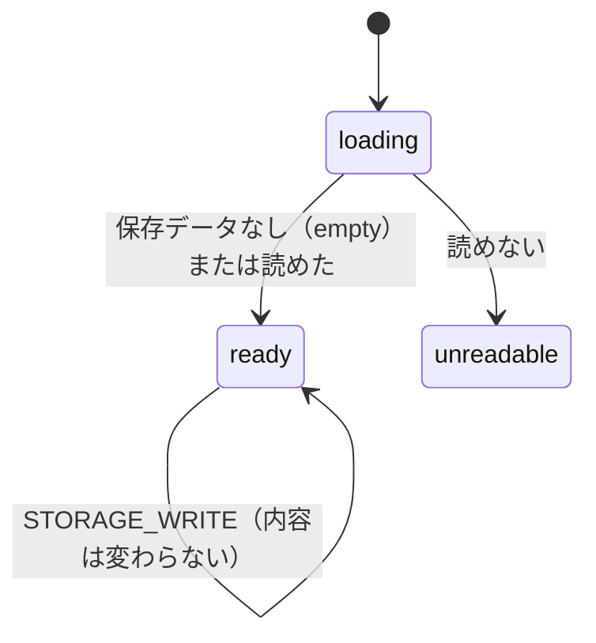
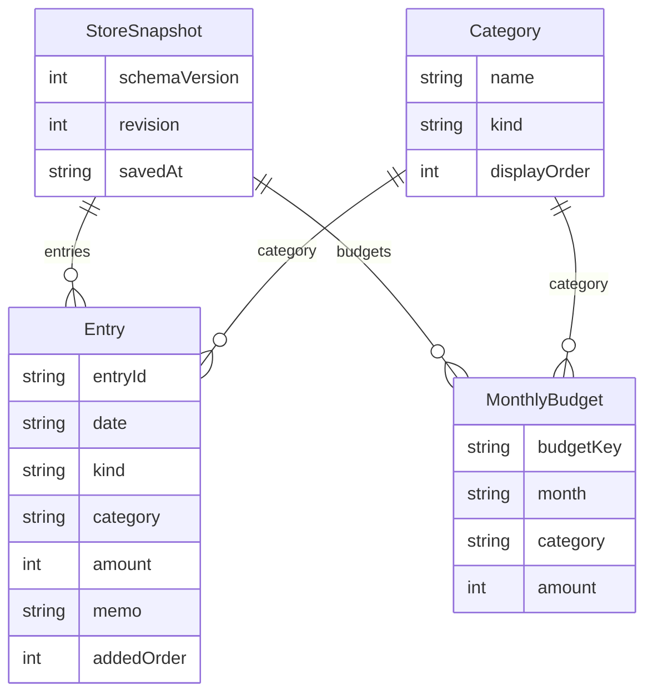

# 機能の仕様 — U1 薄い版（u1-walking-skeleton）

## 入力と前提

- Unit の定義: `aidlc/spaces/default/intents/261016-budget-manager-app/inception/units-generation/unit-of-work.md`（U1）
- ストーリーとの対応: `aidlc/spaces/default/intents/261016-budget-manager-app/inception/units-generation/unit-of-work-story-map.md`（US1.1、US3.1、US5.1、US7.2。US7.3 は登録の保存失敗の表示だけ）
- 要件: `aidlc/spaces/default/intents/261016-budget-manager-app/inception/requirements-analysis/requirements.md`
- 部品の一覧: `aidlc/spaces/default/intents/261016-budget-manager-app/inception/domain-design/components.md`
- 約束ごと: `aidlc/spaces/default/intents/261016-budget-manager-app/inception/contract-design/contract-summary.md`（C1〜C8。C9 は U5）
- 画面の証跡: `aidlc/spaces/default/intents/261016-budget-manager-app/inception/refined-mockups/ui-poc-refined-contract.md`、`mockups.md`、`interaction-spec.md`、`assets/refined-mockup.html`
- このステージの回答: `functional-design-questions.md`（Q1〜Q4、まとめの確認済み）
- 規則: `rules.md`（BR1.1〜BR4.5。この資料の規則の一覧はそこから写したもの）

この資料は、U1 の動きの手順と状態の移り変わりの正本です。データの形は約束ごと C2 が正本です。規則の判定は `rules.md` が正本です。

## U1 で動くこと

1. アプリを開くと、今日を含む月の集計が表示される。
2. 収支を1件登録すると、その月の収入・支出・差額と、カテゴリ別の実績に反映される。
3. すべての明細を CSV ファイルに保存できる。
4. ブラウザを閉じて開き直しても、登録した明細が残っている。
5. 保存できなかったときは、そのことが分かり、入力は残る。

## U1 の範囲の外（あとの Unit が足す）

| 内容 | 足す Unit |
|------|-----------|
| 初回のサンプルデータ、全体のお知らせ枠、別のタブの変更の検知、同時保存の隙間（契約レビュー R-03）、壊れたデータの詳しい検出 | U5 |
| 欄ごとの誤り表示、二重送信の防止、日付の存在の確認、メモの文字数（見える1文字）、別の月で登録したときの表示の切り替え、明細の一覧 | U2 |
| 予算の入力・保存・コピー、予算比較 | U3 |
| CSV の数式対策、取り込み | U4 |
| 通しのアクセシビリティの確認 | U6（基本は U1 でも作り込む） |

## 差し込み口（Q1、契約レビュー R-01）

U1 の部品が、あとの Unit の部品を呼ぶ箇所は2つあります。U1 はどちらにも「空の実装」を置きます。あとの Unit は、アプリを組み立てる1か所（AppShell の組み立て）で本物に差し替えます。U1 のほかのコードは書き換えません。

| 差し込み口 | 呼ぶ側（U1） | U1 の空の実装 | 差し替える Unit | 約束ごと |
|------------|--------------|---------------|-----------------|----------|
| 予算の取り出し（月を渡すと、その月の予算の一覧を返す） | MonthlySummary | いつも空の一覧を返す（すべて「未設定」になる） | U3 Budget.getMonth | C4、C5 |
| 初回のサンプル投入（今日を渡す） | AppShell の起動 | 何もせず成功を返す | U5 SampleDataSeeder.seedIfEmpty | C9 |

```yaml
# 差し込み口の形（説明用。実装の型名は Code Generation で決める）
BudgetSource:
  getMonth(month: YYYY-MM): MonthlyBudget[]     # U1 の空の実装は []
SampleSeeder:                                    # 約束ごと C9 と同じ形
  seedIfEmpty(today: YYYY-MM-DD): Result<StoreSnapshot>
  # U1 の空の実装は何も保存せず、DataStore の今の内容（W1 の空の保存データ）をそのまま ok で返す
```

AppShell は、サンプル投入の戻り値を次のように扱います（W1 の手順 3）。U5 が本物に差し替えても、この扱いは変わりません。

| 戻り値 | AppShell がすること |
|--------|---------------------|
| ok | DataStore の今の内容を使い直し、画面に `committed` と同じ知らせを伝える。U1 の空の実装では内容は空のまま |
| 失敗（error） | 空のまま storeStatus = ready で続ける。保存データは何も残らない（C9）。失敗の知らせを出すのは U5 の全体のお知らせ枠で、U1 は何も出さない（U1 の空の実装は失敗を返さない） |

## 保存の知らせ（Q2、契約レビュー R-02）

保存の部品（DataStore）の知らせに、`committed`（自分の保存が成功した）を1つ足します。約束ごと C2 の「項目を足すだけの変更は互換」に当たり、形は変えません。

| 知らせ | いつ | 受け取った画面がすること | U1 で出すか |
|--------|------|--------------------------|-------------|
| committed | 自分の commit が成功したとき | ReviewView は表示中の月の集計を読み直す。ExportView は持っている表示（お知らせの文）を消す | 出す |
| externalChange | 別のタブが保存し、最新を読み込んだとき | committed と同じ | STALE_REVISION のときの読み直しでだけ出す。別のタブの検知は U5 |
| unreadable | 保存データが読めなくなったとき | 登録を止め、理由を出す | 起動時の読み込みでだけ出す。詳しい検出は U5 |

集計（ReviewView）と CSV（ExportView）は、3つの知らせを同じ受け取り方で扱います。そのため、U5 が検知を足しても、画面の側を書き換える必要はありません。

## 手順（ワークフロー）

### W1 起動

1. AppShell が「今日」を決める（パソコンの地域の時刻）。表示する月 = 今日を含む月（BR2.1）。
2. AppShell が DataStore.load() を呼ぶ。
3. 結果ごとに分かれる（BR4.2）。
   - **empty（保存データなし）**: DataStore は、明細0件・予算0件・通し番号 0 の空の保存データを、まだ書かずに持つ。保存領域に何もないときの通し番号は 0 として照合し、最初の保存で 1 になる（BR4.1）。続けて、サンプル投入の差し込み口を呼ぶ（戻り値の扱いは「差し込み口」の表。U1 では何もしない）。storeStatus = ready。
   - **ready**: 読み込んだ内容を使う。storeStatus = ready。
   - **unreadable**: storeStatus = unreadable。保存データには触れない。次の3か所で、読めないことを伝える（BR4.2、BR4.6）。
     - 登録フォーム: 「登録する」を押せない状態にし、「保存データを読み込めませんでした。データは消していません」と出す。
     - 集計: ¥0 の集計を出さず、「保存データを読み込めないため、集計を表示できません」と出す。
     - CSV: 「明細を CSV に保存」を押せない状態にし、「保存データを読み込めないため、CSV に保存できません。データは消していません」と出す。

     どの画面でも「明細がありません」とは出しません。
4. 画面を組み立てる。登録フォーム、集計（表示中の月）、CSV の説明とボタン。

U1 の「読めない」の判定は最小限です。次のどちらかのときに、読めないとします。

- 保存データが JSON として読めない。
- `schemaVersion` が 1 でない。

項目の欠けや型の誤りの検出は U5 で足します。

### W2 登録（成功）

1. 利用者が、区分・日付・金額・カテゴリ・メモを入力して「登録する」を押す。
2. EntryFormView が Ledger.add(入力) を呼ぶ。
3. Ledger が最小限の判定をする（BR1.1、BR1.2、BR1.3、BR1.4）。満たさなければ W3 へ。
4. Ledger が ID と追加した順の番号を付ける（BR1.6）。
5. Ledger が DataStore.commit({ 期待する通し番号, 追加する明細 }) を呼ぶ（BR4.1）。
6. DataStore が、保存領域の通し番号を読み直して照合する。同じなら、通し番号を1増やして全体を1回で書く。
7. DataStore が `committed` を知らせる（BR4.5）。
8. EntryFormView が「登録しました M月D日 カテゴリ ¥金額」を出す（BR1.5）。区分と日付を残して金額とメモを空にし、金額欄へ操作位置を移す。
9. ReviewView が知らせを受けて、表示中の月の集計を読み直す。登録した明細が表示中の月なら、集計が変わる。

登録した明細が表示中と別の月のとき、U1 では表示の月を切り替えません（切り替えは U2、AC1.3.1）。知らせ（手順 8）は同じように出ます。

### W3 登録（入力の誤り）

1. Ledger が VALIDATION を返す（欄ごとの理由を fieldErrors に持つ）。
2. EntryFormView が、お知らせ枠に「入力を確かめてください: 金額、カテゴリ」のように、直す欄の名前をまとめて出す（Q4）。読み上げ機能に伝わる形（alert）で出す。
3. 入力は残し、最初の誤りの欄へ操作位置を移す。保存はしない。

欄ごとの表示（欄の下に直し方を出す）は U2 で足します。U2 は fieldErrors を使うので、Ledger の返す形は変わりません。

### W4 登録（保存の失敗）

| commit の結果 | 出すこと（お知らせ枠、alert） | そのあと |
|---------------|-------------------------------|----------|
| STORAGE_WRITE | 「このブラウザに保存できませんでした。入力内容は画面に残っています。空き容量を確かめてから、もう一度「登録する」を押してください」（BR4.3） | 入力は残す。読み込んでいる内容は変わらない |
| STALE_REVISION | 「別のタブで変更があったため保存できませんでした。最新の内容を読み込みました。もう一度「登録する」を押してください」（BR4.4） | DataStore が最新を読み直して `externalChange` を知らせ、集計が更新される。入力は残す |
| STORE_UNREADABLE | 「保存データを読み込めませんでした。データは消していません」 | 「登録する」を押せない状態にする。U1 では起動時に読めなければ最初から押せない（W1）ので、通常は起きない。防ぎとして同じ扱いにする。使っている途中で読めなくなる場合は U5 で足す |

どの場合も「登録しました」は出しません（AC7.3.1）。

### W5 月の切り替え

1. 利用者が「前の月」または「次の月」を押す。
2. ReviewView が AppShell.selectMonth(新しい月) を呼ぶ（BR2.2。年をまたぐ）。
3. AppShell が状態の変化を知らせ、ReviewView が新しい月の集計を表示する。月名は読み上げ機能に伝える。

### W6 CSV に保存

1. 利用者が「明細を CSV に保存」を押す。storeStatus が unreadable のときは押せない（W1、BR4.6）。
2. ExportView が CsvExchange.exportAll(今日) を呼ぶ。今日は AppShell から受け取る（BR3.4。契約レビュー R-09 のずれをここで解消）。
3. 明細が0件なら NOT_FOUND を返す。ExportView は「出力する明細がありません」を出し、ファイルは作らない（BR3.5）。
4. 明細があれば、全明細を古い順に並べ（BR3.1）、形式（BR3.2）と囲み（BR3.3）に従って組み立てる。ファイル名は `budget-entries-YYYYMMDD.csv`（BR3.4）。
5. ブラウザのダウンロードで保存する。外部への通信はしない（NFR3）。

### W7 開き直し

1. 利用者がブラウザを閉じて、同じパソコン・同じブラウザで開き直す。
2. W1 の ready になり、保存した明細が集計に反映された状態で表示される（AC7.2.1 の明細の部分）。

## 状態の移り変わり

### 保存データの状態（AppState.storeStatus）



<!-- Text fallback: loading から、保存データがないか読めたら ready、読めなければ unreadable。ready のまま、保存の成功、別タブの先行による読み直し、保存の失敗が起きる。U1 では unreadable から抜ける操作はない（開き直すと再び読み込む）。 -->

U1 では、ready から unreadable への移り変わり（使っている途中で読めなくなる）は扱いません。U5 で足します。

### 登録フォームの状態

```mermaid
stateDiagram-v2
  [*] --> default
  default --> submitting: 「登録する」
  submitting --> success: 保存の成功
  submitting --> invalid: VALIDATION
  submitting --> storageError: STORAGE_WRITE または STALE_REVISION
  submitting --> disabled: STORE_UNREADABLE（防ぎ。U1 では通常起きない）
  success --> submitting: 「登録する」
  invalid --> submitting: 「登録する」
  storageError --> submitting: 「登録する」
  default --> disabled: storeStatus が unreadable
```

<!-- Text fallback: default から「登録する」で submitting。成功なら success、入力の誤りなら invalid、保存の失敗なら storageError。どの状態からも「登録する」で submitting に戻る。保存データが読めないときは disabled。 -->

submitting の間に「登録する」をもう一度押したときの扱い（二重送信の防止、AC1.1.4）は U2 で足します。

## データ（約束ごと C2 から写した見取り図）

データの形の正本は約束ごと C2 です。U1 では、保存データは最初からすべての項目を持ちます。予算は空の配列です。



<!-- Text fallback: StoreSnapshot（schemaVersion, revision, savedAt）は Entry と MonthlyBudget を0件以上持つ。Entry と MonthlyBudget は Category をカテゴリ名で参照する。U1 では MonthlyBudget は常に0件。 -->

保存領域の名前（storageKey）は、DataStore の内部の値で、約束ごとには含めません（契約レビュー R-09）。

## 規則の一覧（`rules.md` から写したもの）

| ID | 内容 |
|----|------|
| BR1.1 | 必須の4項目が空なら登録しない |
| BR1.2 | 金額は 1〜9,999,999 の半角の整数 |
| BR1.3 | 区分に合うカテゴリだけ。切り替えたら合わない選択を解除 |
| BR1.4 | メモは前後の空白を除き、文字として扱う |
| BR1.5 | 登録成功の知らせ（日付・カテゴリ・金額） |
| BR1.6 | 明細の ID と追加した順の番号は Ledger が付ける |
| BR2.1 | 開いたときは今日を含む月 |
| BR2.2 | 前後の月への切り替え（年またぎ） |
| BR2.3 | 収入合計・支出合計・差額を整数で計算 |
| BR2.4 | 差額が負なら「−」 |
| BR2.5 | 支出カテゴリ8つの実績。合計は支出合計と一致 |
| BR2.6 | 金額は ¥ と3桁区切り |
| BR2.7 | 予算なしは「未設定」「—」、超過なし |
| BR3.1〜BR3.6 | CSV の出力（古い順、形式、囲み、ファイル名、0件、説明文） |
| BR4.1〜BR4.6 | 保存（全体を1回、起動時の読み込み、保存失敗、別タブの先行、保存の知らせ、読めないときの集計と CSV） |

## 画面の証跡との対応（詳細モックアップの UI 契約）

U1 で実装する画面の状態です。どれも `assets/refined-mockup.html` の同じ状態を見本にします。

| 画面 | 状態 | 受け入れ条件 | U1 での扱い |
|------|------|--------------|-------------|
| SCREEN-REGISTER | STATE-DEFAULT | AC1.1.1 | 実装する |
| SCREEN-REGISTER | STATE-SAVED | AC1.1.1 | 実装する（BR1.5） |
| SCREEN-REGISTER | STATE-STORAGE-ERROR | AC7.3.1 | 実装する（BR4.3） |
| SCREEN-SUMMARY | STATE-POPULATED | AC3.1.1 | 実装する。予算の列は「未設定」（BR2.7） |
| SCREEN-SUMMARY | STATE-NEGATIVE | AC3.1.2 | 実装する（BR2.4） |
| SCREEN-CSV | STATE-DEFAULT | AC5.1.5 | 出力の部分を実装する（BR3.6）。取り込みの欄は U4 |
| SCREEN-CSV | STATE-EXPORT-EMPTY | AC5.1.4 | 実装する（BR3.5） |
| SCREEN-REGISTER | STATE-VALIDATION-ERROR | AC1.2.1 | U2（U1 はお知らせ枠にまとめて出すだけ） |
| SCREEN-LEDGER | STATE-POPULATED、STATE-EMPTY | AC2.1.1、AC2.1.4 | U2 |
| SCREEN-SUMMARY | STATE-OVER-BUDGET、STATE-BUDGET-UNSET | AC3.2.2、AC3.2.3 | U3 |
| SCREEN-APP | STATE-STORAGE-CORRUPT、STATE-OTHER-TAB-CHANGED | AC7.3.3、AC7.4.1 | U5（U1 は登録・集計・CSV 保存の各区切りでの停止と理由だけ。BR4.6） |

見本の HTML は証跡と動きの仕様であり、機能設計や承認済みのテストの約束を省く根拠にはしません。

## 受け入れ条件の確かめ方（U1 の分）

| 受け入れ条件 | 確かめ方 |
|--------------|----------|
| AC1.1.1 | ブラウザ操作のテストで登録し、知らせの文言と role=status を確かめる |
| AC1.1.2、AC1.1.3 | ブラウザ操作のテストで区分を切り替え、選択肢と解除を確かめる |
| AC3.1.1〜AC3.1.6 | 集計の計算は単体テストで確かめる（300 件 × 9,999,999 円を含む）。表示はブラウザ操作のテストで確かめる |
| AC5.1.1、AC5.1.2、AC5.1.4、AC5.1.5 | 出力の中身（BOM、CRLF、見出し、並び順、囲み）は単体テストで確かめる。ダウンロードのファイル名と0件の表示はブラウザ操作のテストで確かめる |
| AC7.2.1（明細の部分） | ブラウザ操作のテストで登録してから再読み込みし、集計に残っていることを確かめる |
| AC7.3.1 | 保存領域への書き込みを失敗させたテストで、alert の文言・入力が残ること・「登録しました」が出ないことを確かめる |
| AC7.3.3 の U1 分 | 壊れた保存データを置いて開くテストで、次の3つを確かめる。保存データが書き換わっていないことも確かめる。<br>・登録が押せず理由が出ること<br>・集計に ¥0 ではなく理由が出ること<br>・CSV 保存が押せず理由が出ること |

ほかの Unit で確かめる受け入れ条件:

| 受け入れ条件 | Unit |
|--------------|------|
| AC1.1.4、AC1.1.5、AC1.1.6 | U2 |
| AC5.1.3（出力 → 取り込みの往復）、AC7.2.1 の予算の部分 | U4、U3 |
| AC7.3.2 | U3、U4 |
| AC7.3.3（全体のお知らせ枠、予算保存・取り込みの停止）、AC7.3.4 | U5 |

## 未解決の点

なし。了承済みの契約レビューの指摘のうち、U1 で扱うものの扱いは次のとおりです。

- **R-01:** 差し込み口で解消しました。
- **R-02:** `committed` の知らせで解消しました。
- **R-09 の一部:** exportAll に今日を渡し、storageKey は内部の値としました。
- **R-10:** W4 で解消しました。
- **R-03 と R-06:** U5 で扱います。
