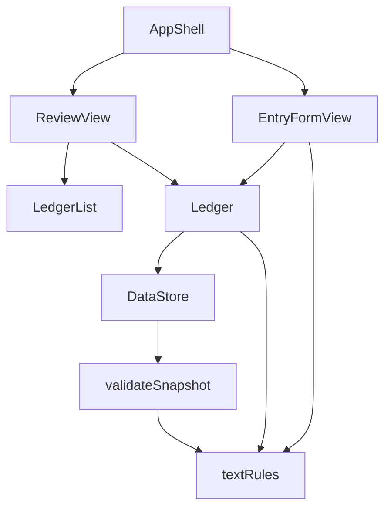

# 論理的な部品の構成 — U2 登録の検証と明細一覧

U1・U5 の構成に、次の部品を足し、変えます。

| 層 | 部品 | 置き場所（予定） | U2 での変化 | 失敗したときに及ぶ範囲 | 当てはまる設計 |
|----|------|-----------------|-------------|------------------------|---------------|
| 計算と規則 | textRules（新規） | `app/src/domain/textRules.ts` | 日付の実在の判定、見える1文字の数え方と切り詰め。validateSnapshot から移す | なし（結果を返すだけ） | NFR5.1、NFR6.1 |
| 計算と規則 | Ledger | `app/src/domain/ledger.ts` | validate の仕上げ（日付の実在、見える1文字、詳しい理由の文） | 呼んだ部品だけ | NFR4.2、NFR5.1、NFR5.2 |
| 計算と規則 | validateSnapshot | `app/src/domain/validateSnapshot.ts` | textRules を使う形にする（動きは同じ） | なし | NFR5.1 |
| 画面 | EntryFormView | `app/src/ui/EntryFormView.tsx` | 欄ごとの誤り、送信の鍵、メモ欄の制限、別の月への切り替えの依頼 | 「1 登録」だけ（Error Boundary） | NFR1.3、NFR2.1、NFR6.2 |
| 画面 | LedgerList（新規） | `app/src/ui/LedgerList.tsx` | 明細の一覧と案内文 | 「2 確認」だけ（Error Boundary） | NFR1.1、NFR2.3、NFR4.1 |
| 画面 | ReviewView | `app/src/ui/ReviewView.tsx` | ledger を受け取り、LedgerList を置く | 「2 確認」だけ | NFR1.1、NFR1.2 |
| 組み立て | AppShell | `app/src/ui/AppShell.tsx` | selectMonth と selectedMonth を EntryFormView に、ledger を ReviewView に渡す | 画面全体 | NFR1.2 |

## 部品の依存の向き

<!-- Text fallback: AppShell は EntryFormView と ReviewView を使い、ReviewView は LedgerList を置く。EntryFormView は Ledger と textRules（メモ欄の制限）を使い、ReviewView は Ledger を使う。Ledger は textRules と DataStore を使い、DataStore は validateSnapshot を使い、validateSnapshot は textRules を使う。textRules は何にも依存しないため、循環はない。 -->

textRules は CategoryCatalog にも依存しない、最も下の部品です。
