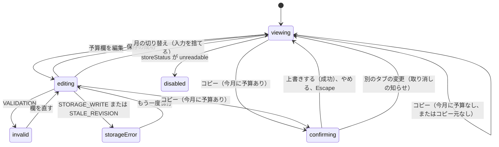

# 機能の仕様 — U3 月別予算と予算比較（u3-budget）

## 入力と前提

- Unit の定義: `aidlc/spaces/default/intents/261016-budget-manager-app/inception/units-generation/unit-of-work.md`（U3。U5 に依存する）
- ストーリー: US3.2（AC3.2.1〜AC3.2.4）、US4.1（AC4.1.1〜AC4.1.3）、US4.2（AC4.2.1〜AC4.2.3）、US7.3 の AC7.3.2（予算の部分）
- 約束ごと: `aidlc/spaces/default/intents/261016-budget-manager-app/inception/contract-design/contract-summary.md`（C4 Budget、C5 MonthlySummary、C2 の budgetsToReplace、C6）
- 実装済みの部品: `app/src/domain/monthlySummary.ts`（予算の差し込み口 BudgetSource）、`app/src/ui/ReviewView.tsx`、`app/src/ui/composition.ts`、`app/src/store/dataStore.ts`
- 画面の証跡: `inception/refined-mockups/ui-poc-refined-contract.md`（SCREEN-SUMMARY の STATE-OVER-BUDGET・STATE-BUDGET-UNSET、SCREEN-BUDGET の STATE-VALIDATION-ERROR・STATE-COPY-CONFIRM・STATE-COPY-EMPTY）、`interaction-spec.md`、`assets/refined-mockup.html`
- このステージの回答: `functional-design-questions.md`（Q1・Q2、まとめの確認済み）
- 規則: `rules.md`（BR1.1〜BR5.3）

## U3 で足すこと

| 内容 | 部品 | U1・U5 からの変化 |
|------|------|-------------------|
| 予算の部品（C4） | Budget（新規。getMonth、saveMonth、previewCopy、copyFromPrevious） | 新規 |
| 予算の差し込み口の差し替え | composition.ts | U1 の空の実装を Budget.getMonth に差し替える（組み立ての1か所。U1 の Q1） |
| 予算の表 | ReviewView（予算の表の部分を BudgetTable に分ける） | 予算の列を、表示だけから入力欄に変える。予算の保存、コピー、確認の枠、知らせを足す |

MonthlySummary の計算（C5）は変えません。差し込み口が本物の予算を返すようになることで、予算・残額・超過が埋まります。

## 約束ごと C4 の使い方

```yaml
Budget:
  getMonth(month): MonthlyBudget[]                    # 設定のあるカテゴリだけ。MonthlySummary の差し込み口にもなる
  saveMonth(month, values: { <支出カテゴリ名>: string }): Result<MonthlyBudget[]>   # BR1.1、BR1.2
  previewCopy(month): Result<{ source: MonthlyBudget[], targetHasBudgets: boolean }> # BR3.1、BR3.2
  copyFromPrevious(month): Result<MonthlyBudget[]>    # BR3.4。呼ぶ前に、targetHasBudgets なら確認する
```

Budget の内部の前提:

- **expectedRevision:** commit を呼ぶ直前に `store.getSnapshot().revision` から取り出す。
- **saveMonth の値:** CategoryCatalog の支出カテゴリ8つの名前だけを読む。欠けている名前は空（未設定）として扱い、それ以外の名前は読まない。
- **copyFromPrevious:** 呼んだ時点の保存データから、前の月の予算を取り出す（previewCopy のあとに保存データが変わっても、呼んだ時点の内容を写す）。確認の枠が開いている間の別のタブの変更は、BR4.2 で枠が閉じるため、古い確認のまま写すことはない。

## 欄の入力値を作り直すきっかけ（BR4.3）

予算欄の入力値は、次の3つのきっかけでだけ、保存済みの予算で作り直します。

1. 表示月が変わったとき（BR4.1）
2. 自分の予算の保存、またはコピーが成功したとき
3. 自分の保存・コピーの結果ではない externalChange を受け取ったとき（BR4.2）

明細の登録など、ほかの部品の保存（committed）では作り直さず、未保存の入力を保ちます。「未保存の入力がある（dirty）」は、欄の値と保存済みの予算を比べて決めます。

STALE_REVISION のとき DataStore は最新を読み込んで externalChange を出しますが、この知らせは自分の処理の結果なので、欄は作り直さず入力を残します（BR5.1）。

画面には、AppShell が externalChange を AppState.lastExternalChangeAt に写してから、あとの描画で届きます。そのため、BudgetTable は「処理中かどうか」の旗だけでは、自分の操作の結果かどうかを区別できません。次のようにして区別します。

1. 自分の保存・コピーが STALE_REVISION を返したら、「次の lastExternalChangeAt の変化を1回だけ無視する」印を立てる。
2. 次に lastExternalChangeAt が変わったとき、この印があれば作り直さずに印を下ろす。
3. それ以外の lastExternalChangeAt の変化では、BR4.2 のとおり作り直す。

## 手順（ワークフロー）

### W1 予算の表の表示

1. ReviewView は、表示中の月の集計（MonthlySummary.summarize）を受け取る。予算は、差し込み口を通して Budget.getMonth の値が入る。
2. 支出カテゴリ8つを固定の順に行にする（BR1.3）。各行に、カテゴリ・予算欄・実績・残額を出す。
3. 予算欄の初期値は、保存済みの予算（なければ空。プレースホルダー「未設定」）。
4. 残額: 予算ありなら「予算 − 実績」、超過なら「超過 ¥N」（BR2.1、BR2.2）。未設定なら「—」（BR2.3）。
5. 表の上に「「予算を保存」を押すまで、予算は保存されません」を出す（BR4.1）。表の下に「予算を保存」と「前の月の予算をコピー」を置く。

### W2 予算の保存

1. 利用者が予算欄を編集し、「予算を保存」を押す。
2. ReviewView が Budget.saveMonth(表示中の月, 8つの欄の値) を呼ぶ。
3. Budget は、すべての欄を検証する（BR1.1）。誤りがあれば VALIDATION と fieldErrors（budget:<カテゴリ名>）を返し、何も保存しない（BR1.2）。
4. 誤りがあれば、ReviewView は次のようにする。入力は残す。
   - 欄の下に理由を出し、aria-invalid と aria-describedby を付ける。
   - お知らせ枠にまとめを出す。
   - 最初の誤りの欄へ操作位置を移す。
5. 誤りがなければ、Budget は commit({ budgetsToReplace }) を1回呼ぶ。
6. 成功したら「10月の予算を保存しました」（BR5.3）。欄を保存済みの予算で作り直す（BR4.3 のきっかけ 2）。保存の知らせ（committed）で、集計が読み直される。
7. 保存の失敗（STORAGE_WRITE、STALE_REVISION）なら BR5.1 の表示を出す。入力は残す（STALE_REVISION なら「1回だけ無視する」印を立て、そのあと届く externalChange で欄を作り直さない）。予算の区切りには、この失敗の知らせだけを出す。
8. STORE_UNREADABLE なら、storeStatus が unreadable になり、W6 の表示に変わる。

### W3 前の月の予算のコピー

1. 利用者が「前の月の予算をコピー」を押す。
2. ReviewView が Budget.previewCopy(表示中の月) を呼ぶ（BR3.1）。
3. NOT_FOUND なら「前の月の予算がありません」を出して終わる（BR3.2）。
4. targetHasBudgets が真、または未保存の入力がある（dirty）なら、ボタンの下に確認の枠を出し、「上書きする」へ操作位置を移す（BR3.3）。未保存の入力があるときは「保存していない予算の入力は失われます」を枠に添える。
   - 「やめる」か Escape（操作位置が確認の枠の中にあるとき）: 枠を閉じ、コピーのボタンへ操作位置を戻す。何も変えない。
   - 「上書きする」: 手順 5 へ。
5. Budget.copyFromPrevious(表示中の月) を呼ぶ（BR3.4。まるごと置き換え）。STALE_REVISION なら「1回だけ無視する」印を立てる。
6. 成功なら「前の月の予算を10月に写しました」（BR5.3）。予算欄は写した値で作り直す（BR4.3 のきっかけ 2）。
7. 保存の失敗なら、コピーの失敗の文言（BR5.1）を出し、確認の枠を閉じて、コピーのボタンへ操作位置を移す。予算は変わらない。

### W4 月の切り替え

1. 利用者が「前の月」「次の月」を押す。
2. ReviewView は、未保存の入力と、開いている確認の枠を捨て、新しい月の保存済みの予算で欄を作り直す（BR4.1）。誤りの表示も消す。

### W5 別のタブの変更

1. AppShell から externalChange を受け取る（U5）。「1回だけ無視する」印があれば、印を下ろして手順 2・3 は行わない（自分の STALE_REVISION の結果のため。W2・W3 の失敗の扱いに任せる）。
2. 確認の枠が開いていれば閉じ、「別のタブで変更があったため、確認を取り消しました。もう一度操作してください」を出す。枠が開いておらず未保存の入力があれば、「別のタブで変更があったため、保存していない予算の入力を最新の内容に置き換えました」を出す（BR4.2）。
3. 予算欄は、表示中の月の最新の予算で作り直す。

### W6 保存データが読めない

U1 の集計の停止のとおり、予算の表を出さずに理由を出す。予算の保存とコピーは操作できない（BR5.2）。

## 状態の移り変わり（予算の区切り）



<!-- Text fallback: viewing から編集で editing。保存が成功すれば viewing、入力の誤りは invalid、保存の失敗は storageError。コピーで今月に予算があれば confirming になり、上書き・やめる・Escape・別タブの変更で viewing に戻る。月の切り替えで入力を捨てて viewing。保存データが読めなければ disabled。 -->

## 規則の一覧（`rules.md` から写したもの）

| ID | 内容 |
|----|------|
| BR1.1〜BR1.3 | 予算の値、まとめて検証して1か月だけ置き換え、支出カテゴリだけ |
| BR2.1〜BR2.3 | 予算・実績・残額、超過、未設定 |
| BR3.1〜BR3.4 | コピー元、コピー元なし、上書きの確認、まるごと置き換え |
| BR4.1、BR4.2 | 未保存の入力、別のタブの変更 |
| BR5.1〜BR5.3 | 保存の失敗、読めないとき、成功の知らせ |

## 画面の証跡との対応（詳細モックアップの UI 契約）

| 画面 | 状態 | 受け入れ条件 | U3 での扱い |
|------|------|--------------|-------------|
| SCREEN-SUMMARY | STATE-OVER-BUDGET | AC3.2.2 | 実装する（BR2.2） |
| SCREEN-SUMMARY | STATE-BUDGET-UNSET | AC3.2.3 | 実装する（BR2.3） |
| SCREEN-BUDGET | STATE-VALIDATION-ERROR | AC4.1.2 | 実装する（BR1.1、BR1.2） |
| SCREEN-BUDGET | STATE-COPY-CONFIRM | AC4.2.2 | 実装する（BR3.3） |
| SCREEN-BUDGET | STATE-COPY-EMPTY | AC4.2.3 | 実装する（BR3.2） |

## 受け入れ条件の確かめ方（U3 の分）

| 受け入れ条件 | 確かめ方 |
|--------------|----------|
| AC3.2.1〜AC3.2.4 | Budget と MonthlySummary の単体テスト、画面のテスト |
| AC4.1.1〜AC4.1.3 | Budget.saveMonth の単体テスト（境界、ほかの月が変わらない、空欄で未設定）と、ブラウザ操作のテスト |
| AC4.2.1〜AC4.2.3 | Budget のコピーの単体テストと、確認の枠のブラウザ操作のテスト（上書き、やめる、Escape） |
| AC7.3.2（予算の部分） | 書き込みを失敗させたテストで、予算の区切りに失敗の表示が出て、成功の表示が出ないことを確かめる |
| AC7.2.1（予算の部分。U1 から持ち越し） | 予算を保存してから再読み込みし、予算が残っていることを確かめる |
| AC7.1.2（U5 から持ち越し） | サンプルで、ある月に超過、ある月に未設定が表示されることを確かめる |
