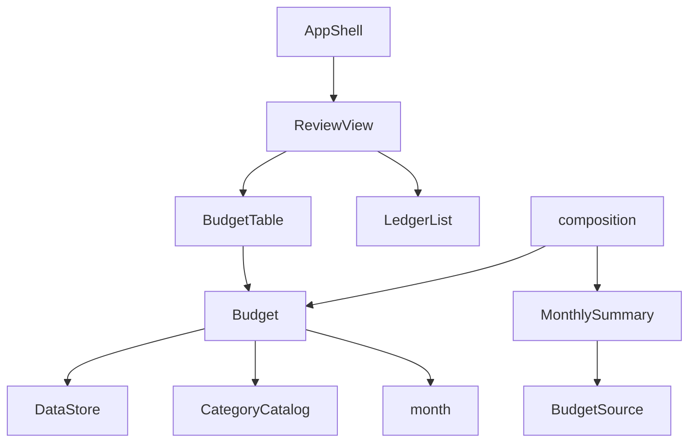

# 論理的な部品の構成 — U3 月別予算と予算比較

U1・U5・U2 の構成に、次の部品を足し、変えます。

| 層 | 部品 | 置き場所（予定） | U3 での変化 | 失敗したときに及ぶ範囲 | 当てはまる設計 |
|----|------|-----------------|-------------|------------------------|---------------|
| 計算と規則 | Budget（新規） | `app/src/domain/budget.ts` | C4 の getMonth、saveMonth、previewCopy、copyFromPrevious | 呼んだ部品だけ。結果の値で失敗を返す | NFR1.1、NFR1.2、NFR4.1、NFR5.1、NFR5.3 |
| 組み立て | composition.ts | `app/src/ui/composition.ts` | 予算の差し込み口（BudgetSource）を Budget.getMonth に差し替え、AppServices に budget を足す | 画面全体 | NFR7.2 |
| 組み立て | AppShell | `app/src/ui/AppShell.tsx` | AppState に externalChangeSeq を足し、budget と externalChangeSeq を ReviewView に渡す | 画面全体 | NFR5.2 |
| 画面 | ReviewView | `app/src/ui/ReviewView.tsx` | U1 の支出カテゴリ別の表を BudgetTable に置き換える | 「2 確認」だけ（Error Boundary） | NFR1.1 |
| 画面 | BudgetTable（新規） | `app/src/ui/BudgetTable.tsx` | 予算欄、保存、コピー、確認の枠、知らせ、欄の作り直し | 「2 確認」だけ（Error Boundary） | NFR2.1〜NFR2.3、NFR5.2、NFR6.1 |

## 部品の依存の向き

<!-- Text fallback: AppShell は ReviewView を使い、ReviewView は BudgetTable と LedgerList を置く。BudgetTable は Budget を使う。MonthlySummary は BudgetSource という差し込み口だけを知り、組み立て（composition）が Budget.getMonth をそこに差し込む。Budget は DataStore、CategoryCatalog、月の計算（month）を使う。MonthlySummary は Budget を直接知らないため、循環はない。 -->

MonthlySummary は Budget を直接 import せず、差し込み口（BudgetSource）だけを知ります（U1 の Q1）。そのため、依存の向きは Unit の順番（U1 → U3）と合います。
