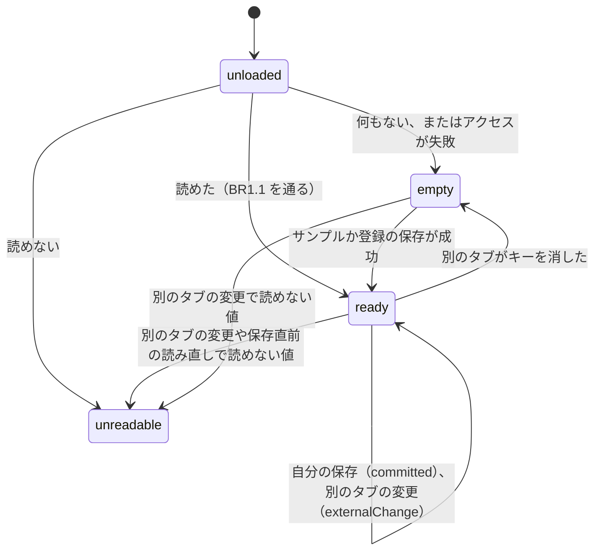
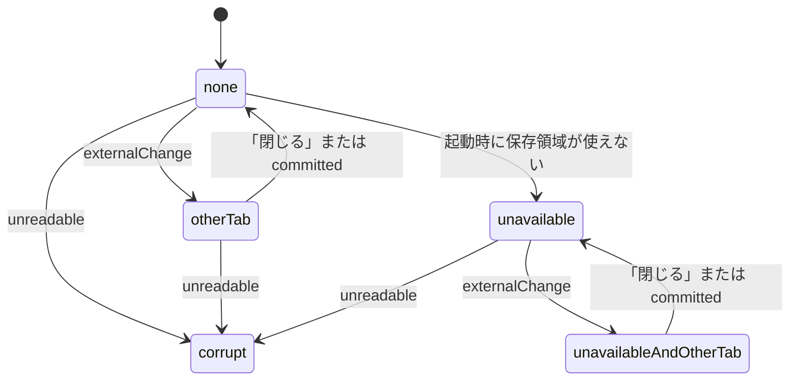

# 機能の仕様 — U5 保存の異常・別タブ対応・サンプル（u5-storage-resilience）

## 入力と前提

- Unit の定義: `aidlc/spaces/default/intents/261016-budget-manager-app/inception/units-generation/unit-of-work.md`（U5。U1 だけに依存し、U2・U3・U4 が U5 に依存する）
- ストーリー: US7.1（AC7.1.1〜AC7.1.4）、US7.3（AC7.3.3、AC7.3.4。AC7.3.1 は U1 で実装済み、AC7.3.2 は U3・U4）、US7.4（AC7.4.1、AC7.4.2）
- 約束ごと: `aidlc/spaces/default/intents/261016-budget-manager-app/inception/contract-design/contract-summary.md`（C2、C3、C6、C9）
- U1 の機能設計と実装: `aidlc/spaces/default/intents/261016-budget-manager-app/construction/u1-walking-skeleton/functional-design/`、`app/src/store/dataStore.ts`、`app/src/ui/composition.ts`、`app/src/ui/AppShell.tsx`
- 画面の証跡: `inception/refined-mockups/ui-poc-refined-contract.md`（SCREEN-APP の STATE-STORAGE-CORRUPT と STATE-OTHER-TAB-CHANGED）、`interaction-spec.md`（全体のお知らせ枠 AppBanner）
- このステージの回答: `functional-design-questions.md`（Q1〜Q4、まとめの確認済み）
- 規則: `rules.md`（BR1.1〜BR5.4。この資料の規則の一覧はそこから写したもの）

この資料は、U5 の動きの手順と状態の移り変わりの正本です。データの形は約束ごと C2 が正本です。

## U5 で足すこと

| 内容 | 部品 | U1 からの変化 |
|------|------|---------------|
| 保存データの詳しい検査（BR1.1） | DataStore | U1 の「JSON・版だけ」の判定を、C2 の全項目の検査に強化する |
| 別のタブの変更の検知（BR2.1） | DataStore | ブラウザのタブ間の知らせを受け取り、`externalChange`・`unreadable` を出す |
| 使っている途中で読めなくなったとき（BR1.2、BR5.1） | DataStore、AppShell | U1 は起動時だけだった unreadable を、途中でも扱う |
| 保存領域が使えない環境の知らせ（BR3.1、BR5.3） | DataStore、AppShell | 状態として「保存領域が使えない」を持つ |
| 全体のお知らせ枠（BR5.1〜BR5.4） | NoticeBannerView（新規） | U1 の置き場所に作る |
| 初回のサンプル（BR4.1〜BR4.5） | SampleDataSeeder（新規）、Ledger | U1 の何もしない実装を、組み立ての1か所で差し替える |
| 複数件の採番（BR4.5） | Ledger | 約束ごと C3 に、複数件にまとめて ID と追加した順の番号を付ける関数を足す（項目を足すだけの変更） |

保存の呼び出しの形（同期の `commit`）は変えません（Q1）。

## 約束ごとへの追加（項目を足すだけの変更）

```yaml
# C2 DataStore への追加
DataStore:
  getAvailability(): available | unavailable   # 起動時に保存領域へアクセスできたか（BR3.1）
  subscribe: events に変更なし（committed・externalChange・unreadable）
  load(): 1回目の呼び出しの中で、タブ間の知らせ（storage イベント）の受け取りを1回だけ始める（2回目以降は始めない）
  dispose(): タブ間の知らせの受け取りをやめ、受け取り手をすべて外す（テストと画面の片付け用）
# 保存データの検査（BR1.1）
validateSnapshot(value: unknown): { ok: StoreSnapshot } | { reason: string }
  # app/src/domain の下の純粋な関数。CategoryCatalog だけを使い、Ledger と DataStore には依存しない
# C3 Ledger への追加
Ledger:
  assignIdentities(validated: ValidatedEntry[], existing: Entry[]):   # BR4.5
    returns: Entry[]   # 入力の順に addedOrder を振る。ID は既存と重ならない
# C6 AppState への追加
AppState:
  storageAvailable: boolean                    # BR3.1
```

U4 の取り込み（addMany）も、同じ `assignIdentities` を使えます。

## 手順（ワークフロー）

### W1 起動（U1 の W1 に足すこと）

1. AppShell が「今日」を決め、DataStore.load() を呼ぶ。
2. DataStore は、保存領域を読み、結果ごとに分かれる。
   - **アクセスが失敗:** 「保存データなし」と同じに扱い、保存領域が使えない（unavailable）と記録する（BR3.1）。
   - **何もない:** empty。
   - **読めた:** BR1.1 の検査を通れば ready。通らなければ unreadable（保存データには触れない）。
3. DataStore は、load の中で、ブラウザのタブ間の知らせ（storage イベント）の受け取りを1回だけ始める（W3）。
4. AppShell は、結果が empty（アクセスが失敗したときも含む）なら、サンプル投入（SampleDataSeeder.seedIfEmpty(今日)）を呼ぶ。結果ごとの DataStore の動きは次のとおり。
   - **ok:** DataStore はサンプルの入った内容になっている。
   - **STALE_REVISION:** 別のタブが先に保存していた。DataStore は、そのタブの最新の内容を採用している（空ではない）。
   - **STORE_UNREADABLE:** 保存直前の読み直しで読めない値を見つけた。DataStore は unreadable になっている。
   - **STORAGE_WRITE:** 保存できなかった（保存領域が使えないときを含む）。DataStore は空のまま。
5. AppShell は、サンプル投入の成否にかかわらず、投入のあとに DataStore.getStatus() と getAvailability() を読み直し、storeStatus（ready・unreadable）と storageAvailable を決める。起動中に DataStore が出した知らせは、画面がまだ受け取りを始めていないため使わず、この読み直しで状態をそろえる。画面は最初の表示で、DataStore の今の内容を読む。
6. 全体のお知らせ枠を、状態に合わせて出す（BR5.4）。
   - unreadable なら BR5.1。
   - 保存領域が使えないなら BR5.3。
7. 画面が受け取りを始めたあと（AppShell の購読の開始）にもう一度 getStatus() を読み、手順 5 からの間に状態が変わっていたら合わせる。

### W2 初回のサンプル投入

1. SampleDataSeeder は、今日から3か月（今日の月と、その前の2か月）を決める（BR4.1）。
2. 決まった並びで、明細の入力（区分・日付・金額・カテゴリ・メモ）と予算を組み立てる（BR4.2〜BR4.4）。乱数は使わない。
3. 各明細を Ledger.validate で確かめる。1件でも合わなければ、保存せず失敗を返す（BR4.5。テストで検出する誤り）。
4. Ledger.assignIdentities で ID と追加した順の番号を付ける（BR4.5）。
5. 予算は、C2 の MonthlyBudget の形で組み立てる。budgetKey は「月:カテゴリ」にする。
6. DataStore.commit({ expectedRevision: 0, initialize: 保存データ }) を1回だけ呼ぶ（全部か無か）。
7. 結果を返す。保存データがすでにあれば、commit が断り、何も変わらない。

サンプルの中身（3か月分。M = 今日の月、M-1・M-2 = その前の月）:

| 項目 | 内容 |
|------|------|
| 収入 | 毎月「給与」1件（例: 280,000 円）。M-1 に「副収入」1件 |
| 支出 | 毎月 14〜19 件を、8つの支出カテゴリに散らす。メモは「スーパー」「電気代」「スマホ代」「定期券」「日用品」「外食」「本」などの一般名詞 |
| 日付 | その月の中。M は今日までの日だけ |
| 予算 | 3か月とも、食費・住居費・水道光熱費・通信費・日用品・交通費の6つに設定。娯楽・その他支出は未設定 |
| 超過 | M-1 の食費は、実績が予算を上回る（例: 予算 40,000 円、実績 43,900 円） |

具体の金額と件数の表は、コード生成の計画で決めます。合否の基準は BR4.2〜BR4.4 とストーリーの AC7.1.1〜AC7.1.4 です。

### W3 別のタブの変更を受け取る

1. ブラウザが、別のタブの保存を知らせる（storage イベント。自分のタブの保存では来ない）。
2. DataStore は、知らせの storageArea が localStorage で、key がこのアプリのキーか null（localStorage 全体が消された）かを確かめる。そうでなければ何もしない。状態が unreadable なら、どの知らせも無視する（開き直すまで unreadable のまま。BR5.1 も出し続ける）。
3. 新しい値を BR1.1 で検査する（BR2.1）。
   - 読める: 手元の写しを入れ替え、`externalChange` を出す。
   - 読めない: unreadable にし、`unreadable` を出す。
   - キーが消された（値がない、または key が null）: 空の写し（通し番号 0）にし、`externalChange` を出す。
4. AppShell は、受け取った知らせに合わせて次のようにする。
   - `externalChange` なら、AppState の lastExternalChangeAt を更新し、画面に読み直させる。全体のお知らせ枠に BR5.2 を出す。
   - `unreadable` なら、storeStatus を unreadable にする。
5. 登録フォームに入力中の値は消さない（BR2.2）。

### W4 自分の保存のあと

1. DataStore が `committed` を出す（U1 の保存の知らせの規則）。
2. AppShell は、全体のお知らせ枠の BR5.2（別のタブの変更）を消す。

### W5 使っている途中で読めなくなる

次の2つの場合に起きます。

- W3 の手順 3 で、読めない値を受け取ったとき。
- 保存の直前の読み直しで、読めない値を見つけたとき（U1 の commit の手順 3）。

1. DataStore が unreadable になり、`unreadable` を出す。
2. AppShell は、storeStatus を unreadable にする。各区切りは、U1 の規則（読めないときの登録・集計・CSV の停止）のとおり止まって理由を出す。全体のお知らせ枠に BR5.1 を出す。
3. 保存データには書かない（BR1.2）。

### W6 全体のお知らせ枠の「閉じる」

1. 利用者が、別のタブの変更の知らせ（BR5.2）の「閉じる」を押す。
2. NoticeBannerView は、その知らせを消し、操作位置を本文の先頭（「1 登録」の見出し）に移す。BR5.1・BR5.3 には「閉じる」を置かない。

## 状態の移り変わり

### 保存データの状態（DataStore）



<!-- Text fallback: unloaded から、何もないかアクセス失敗なら empty、読めれば ready、読めなければ unreadable。empty は保存の成功で ready。ready は自分の保存や別タブの変更で ready のまま、キーが消されると empty、読めない値で unreadable。empty も別タブの読めない値で unreadable。unreadable から抜ける操作はない（開き直すと再び読み込む）。 -->

保存領域が使えるかどうか（available・unavailable）は、起動時に決めて、使っている間は変えません。unavailable のときも、操作は止めません。ただし保存はすべて STORAGE_WRITE で失敗し、手元の写しも画面も変わりません（U1 のとおり。登録では「このブラウザに保存できませんでした」が出る）。

unreadable になったら、別のタブから読める値の知らせが届いても ready には戻りません（W3 の手順 2）。

### 全体のお知らせ枠



<!-- Text fallback: 知らせなしから、別タブの変更で otherTab（閉じるか自分の保存で消える）。起動時に保存できなければ unavailable（閉じられない）。読めなくなればどこからでも corrupt になり、corrupt の知らせだけを出し続ける。 -->

## 規則の一覧（`rules.md` から写したもの）

| ID | 内容 |
|----|------|
| BR1.1 | 読み込み時に C2 の形とすべて照らす |
| BR1.2 | 読めないときは保存の操作を止め、サンプルも入れ直さない |
| BR2.1 | 別のタブの変更を検知して最新を読み込む |
| BR2.2 | 別のタブの変更でも入力中の内容は消さない |
| BR2.3 | 1 ミリ秒未満の同時保存の隙間は残るリスク |
| BR3.1 | 保存領域が使えないことを起動時に知らせる |
| BR4.1〜BR4.5 | サンプル（3か月を1回で、件数と未来日なし、予算6つと超過、一般的なメモ、同じ規則で確かめて採番） |
| BR5.1〜BR5.4 | 全体のお知らせ枠（読めない、別タブの変更、保存できない、優先順） |

## 画面の証跡との対応（詳細モックアップの UI 契約）

| 画面 | 状態 | 受け入れ条件 | U5 での扱い |
|------|------|--------------|-------------|
| SCREEN-APP | STATE-STORAGE-CORRUPT | AC7.3.3 | 実装する（BR5.1。登録・集計・CSV の停止は U1 で実装済み） |
| SCREEN-APP | STATE-OTHER-TAB-CHANGED | AC7.4.1 | 実装する（BR5.2） |
| SCREEN-SUMMARY | STATE-OVER-BUDGET、STATE-BUDGET-UNSET | AC3.2.2、AC3.2.3 | サンプルにデータを入れる。表示は U3（U3 までは予算の差し込み口が空のため、予算は表示されない） |

## 受け入れ条件の確かめ方（U5 の分）

| 受け入れ条件 | 確かめ方 |
|--------------|----------|
| AC7.1.1 | 単体テストで、空の保存領域から seedIfEmpty を呼び、3か月分の明細と予算が1回の保存で入ることを確かめる。ブラウザ操作のテストで、初回に開くと明細が集計に出ることを確かめる |
| AC7.1.2 | 単体テストで、サンプルの予算と実績から、ある月に超過、ある月に未設定があることを確かめる（表示は U3 で確かめる） |
| AC7.1.3 | ブラウザ操作のテストで、2回目に開いても明細の数が増えないことを確かめる |
| AC7.1.4 | 単体テストで、すべてのメモが決めた一般名詞の一覧の中にあることを確かめる |
| AC7.3.3 | ブラウザ操作のテストで、壊れた保存データ（項目の型の誤りを含む）を置いて開き、全体のお知らせ枠の alert と、操作の停止を確かめる |
| AC7.3.4 | ブラウザ操作のテストで、AC7.3.3 のあと開き直しても、保存データが書き換わっていないことを確かめる |
| AC7.4.1 | ブラウザ操作のテストで、同じページを2つ開き、片方で登録すると、もう片方に知らせが出て集計が更新されることを確かめる |
| AC7.4.2 | AC7.4.1 のあと、もう片方で登録しても、最初の明細が残っていることを確かめる |

## 残るリスク

- **2つのタブの同時保存の隙間（BR2.3、Q1）:** 保存直前の読み直しと書き込みの間（1 ミリ秒未満）に別のタブが書くと、先に保存した側の変更が失われる可能性があります。1人が手で操作する使い方では、現実には起きないと判断しました。防ぐ仕組み（Web Locks API）は、保存の呼び出しの形を非同期に変える必要があるため入れません。
- **サンプルの投入中の別タブ:** 初回に2つのタブを同時に開くと、両方がサンプルを入れようとします。後のタブは通し番号の照合で断られ、二重にはなりません。

## 未解決の点

なし。了承済みの契約レビューの指摘のうち、U5 で扱うものの扱いは次のとおりです。

- R-03: BR2.3 で、残るリスクとして記録しました。
- R-06: SnapshotChange は initialize だけを使い、採番は Ledger.assignIdentities で行います。
