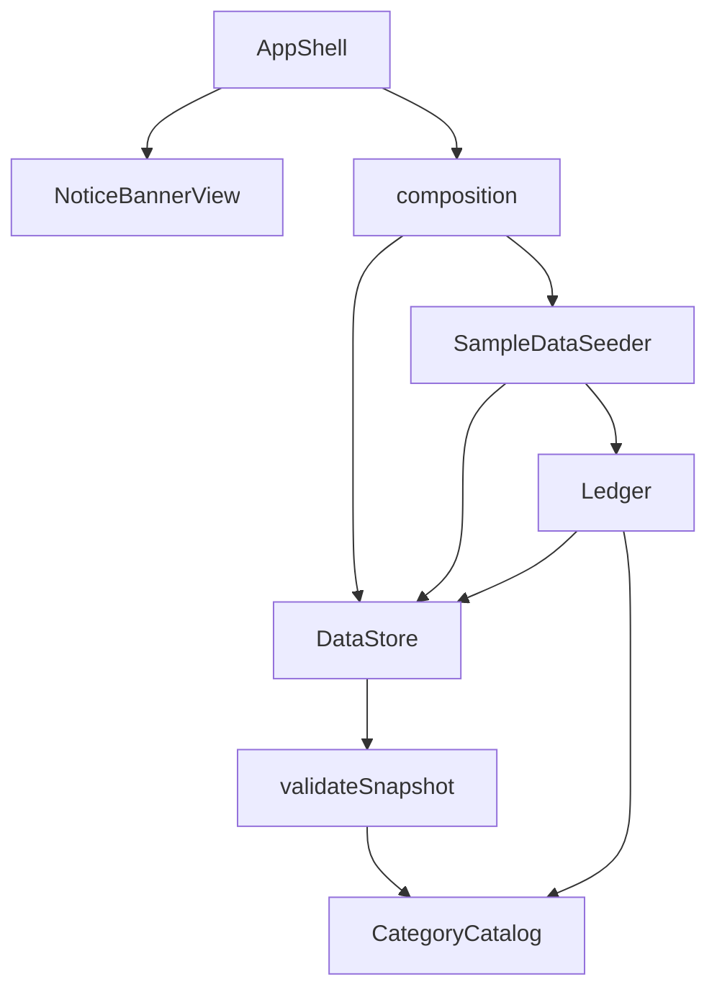

# 論理的な部品の構成 — U5 保存の異常・別タブ対応・サンプル

U1 の構成（`aidlc/spaces/default/intents/261016-budget-manager-app/construction/u1-walking-skeleton/nfr-design/logical-components.md`）に、次の部品を足し、変えます。

| 層 | 部品 | 置き場所（予定） | U5 での変化 | 失敗したときに及ぶ範囲 | 当てはまる設計 |
|----|------|-----------------|-------------|------------------------|---------------|
| 計算と規則 | validateSnapshot（新規） | `app/src/domain/` | 保存データの検査（BR1.1）。CategoryCatalog だけを使う純粋な関数 | なし（結果を返すだけ） | NFR1.3、NFR4.1、NFR4.2 |
| 計算と規則 | Ledger | `app/src/domain/ledger.ts` | assignIdentities を足す（複数件の採番） | 呼んだ部品だけ | NFR5.1 |
| 計算と規則 | SampleDataSeeder（新規） | `app/src/domain/` | 初回のサンプルの組み立てと投入 | 起動時だけ。失敗しても空のまま続く | NFR1.2、NFR3.1、NFR5.1、NFR5.4 |
| 保存 | DataStore | `app/src/store/dataStore.ts` | 検査の強化、storage イベント、getAvailability、dispose | 保存の操作すべて。壊れた保存データには書かない | NFR1.1、NFR4.1、NFR5.2〜NFR5.4、NFR6.1 |
| 組み立て | composition.ts | `app/src/ui/` | サンプル投入の差し込み口を SampleDataSeeder に差し替える | 画面全体 | NFR1.2 |
| 組み立て | AppShell | `app/src/ui/` | 投入後の状態の読み直し、storageAvailable、別のタブの変更の知らせの表示の有無 | 画面全体（最も外側の Error Boundary で受け止める） | NFR1.1、NFR2.1 |
| 画面 | NoticeBannerView（新規） | `app/src/ui/` | 全体のお知らせ枠 | その枠だけ（Error Boundary で囲む） | NFR2.1、NFR2.2 |

## 部品の依存の向き

<!-- Text fallback: AppShell は NoticeBannerView と組み立て（composition）を使う。組み立ては SampleDataSeeder と DataStore を作る。SampleDataSeeder は Ledger と DataStore を使い、Ledger は DataStore を使う。DataStore は validateSnapshot を使い、validateSnapshot と Ledger は CategoryCatalog を使う。循環はない。 -->

検査の関数は Ledger に依存しないため、Ledger → DataStore → Ledger の循環はできません（機能設計レビュー R-04）。

## 共有するもの

| 共有するもの | 持ち主 | 使う側 | 注意 |
|-------------|--------|--------|------|
| 保存データ（localStorage の1つのキー） | DataStore | このアプリのすべてのタブ | 別のタブの書き込みは storage イベントで受け取る。読み込みのたびに検査する |
| サンプルのメモの一覧 | SampleDataSeeder | テスト | 一般名詞だけ（NFR3.1） |
| 全体のお知らせ枠の状態 | AppShell | NoticeBannerView | 優先順は BR5.4 |
