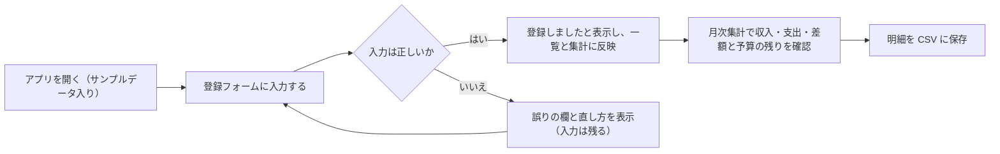

# 利用の流れと情報構成 — 架空データの予算管理Webアプリ

成功基準（`aidlc/spaces/default/intents/261016-budget-manager-app/ideation/intent-capture/intent-statement.md`）と、範囲定義書（`aidlc/spaces/default/intents/261016-budget-manager-app/ideation/scope-definition/scope-document.md`）、意図バックログ（`aidlc/spaces/default/intents/261016-budget-manager-app/ideation/scope-definition/intent-backlog.md`）にもとづく流れです。

## 主な流れ（成功基準）



<!-- Text fallback: アプリを開く（サンプルデータ入り）→ 登録フォームに入力する → 入力が正しければ「登録しました」と表示して一覧と集計に反映し、誤りがあれば誤りの欄と直し方を表示してフォームに戻る（入力は残る）→ 月次集計で収入・支出・差額と予算の残りを確認 → 明細を CSV に保存。 -->

```
流れ: 収支を登録して月の状況を確認し、CSV に保存する
利用者: 依頼者本人
きっかけ: 家計の収支を記録したい
手順:
  1. 登録フォーム -> 区分・日付・金額・カテゴリ・メモを入力して「登録する」 -> 「登録しました」と表示
  2. 月次集計 -> 月を確認 -> 収入・支出・差額と、カテゴリ別の予算・実績・残額を表示
  3. CSV -> 「明細を CSV に保存」 -> CSV ファイルを保存
成功: 3つの操作を迷わず終え、CSV ファイルが手元に残る
エラー:
  - 金額が整数でない、または 0 以下 -> 欄の下に直し方を表示 -> 直して再度登録
  - ブラウザに保存できない -> 保存できなかったことと再試行の方法を表示 -> 入力は残したまま再試行
```

## 補助の流れ

### 月ごとの予算を設定する

```
手順:
  1. 月次集計 -> 「10月の予算を設定」 -> カテゴリごとの予算額の入力欄を表示
  2. 金額を入力して保存 -> 月次集計に予算・実績・残額を表示
エラー:
  - 予算が未設定 -> 予算と残額の欄に「未設定」を表示し、設定を案内
```

### CSV を取り込んで明細に追加する

```
手順:
  1. CSV -> 「CSV を取り込んで追加」 -> ファイルを選ぶ
  2. 取り込み結果 -> 追加した件数と、既存の明細が残っていることを表示
エラー:
  - 一部の行が読めない -> 追加できた件数と、取り込めなかった行番号・理由を表示 -> CSV を直して取り込み直す
注意: 同じ CSV を2回取り込むと明細が重複する。扱いは要件分析で決める（範囲定義書「後続の段階で詰める点」）
```

## 情報構成（Information Architecture）

```
予算管理
+-- 収支を登録（最初に目に入る）
|   +-- 区分（支出 / 収入）、日付、金額、カテゴリ、メモ
+-- 明細の一覧（月ごと、新しい順）
+-- 月次集計（月の切り替え）
|   +-- 収入合計・支出合計・差額
|   +-- カテゴリ別の予算・実績・残額
|   +-- 予算の設定（月ごと）
+-- CSV
    +-- 明細を CSV に保存
    +-- CSV を取り込んで追加
```

どの機能も、最初の画面から1回の操作で届く浅い構成です。ラフ案A は上から順に、ラフ案B はタブで、ラフ案C は左右に並べて、この構成を表現しています（`wireframes.md`）。
