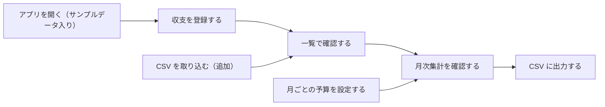

# 意図バックログ — 架空データの予算管理Webアプリ

意図ステートメント（`aidlc/spaces/default/intents/261016-budget-manager-app/ideation/intent-capture/intent-statement.md`）と、範囲定義の回答（`scope-definition-questions.md`）をもとに作成しています。

## 優先度の付け方

依頼者本人が1人で使い、範囲が固定された試作であるため、MoSCoW 法で優先度を付けます。範囲に含める機能はすべて Must（最初のバージョンに必須）で、並べる順番は価値優先（Q8）とします。成功基準の流れ「登録 → 月次集計を確認 → CSV に出力」が、できるだけ早くつながる順番です。

## バックログ（作業のまとまりの候補）

| 順 | ID | まとまり | 内容 | 優先度 | 先に必要なもの | 出典 |
|----|----|----------|------|--------|----------------|------|
| 1 | PU-1 | 収支の登録と一覧 | 用意済みカテゴリから選んで収入・支出を登録し、一覧で見る。架空のサンプルデータが最初から入っていて、開き直してもデータが残る | Must | なし | Q1, Q2, Q6, Q7 |
| 2 | PU-2 | 月次集計（収支） | 指定した月の収入合計・支出合計・差額を表示する | Must | PU-1 | Q4 |
| 3 | PU-3 | 収支明細の CSV 出力 | 収支明細を CSV ファイルとして保存する | Must | PU-1 | Q5 |
| 4 | PU-4 | カテゴリ別の月次予算と予算比較 | 月ごとにカテゴリ別の予算額を設定し、月次集計にカテゴリ別の予算・実績・残額を表示する | Must | PU-1, PU-2 | Q3, Q10 |
| 5 | PU-5 | 収支明細の CSV 取り込み | 収支明細の CSV ファイルを取り込み、既存の明細に追加する | Must | PU-1 | Q5, Q12 |

PU-1 から PU-3 までで、成功基準の流れがひととおりつながります。PU-4 と PU-5 は、その流れに予算の比較と取り込みを加えます。

## 今回は作らないもの（Won't Have this time）

- 登録済み明細の修正・削除、一覧の絞り込み・検索（Q1, Q11）
- カテゴリの追加・名前変更・削除（Q2）
- 予算設定の CSV 入出力、月次集計結果の CSV 出力（Q5）
- 全データの一括消去・サンプルデータへの初期化（Q11 で選ばれなかった）
- 利用者認証・複数利用者でのデータ共有、実口座連携・外部送信（意図の把握で確認済み）

## 価値の流れ（Value Stream）

<!-- Text fallback: アプリを開く（サンプルデータ入り）→ 収支を登録する → 一覧で確認する → 月次集計を確認する → CSV に出力する。月ごとの予算の設定は月次集計に、CSV の取り込み（追加）は一覧に流れ込む。 -->

主の流れ（上の段）が成功基準そのものです。予算の設定と CSV の取り込みは、この流れに合流する補助の流れです。
