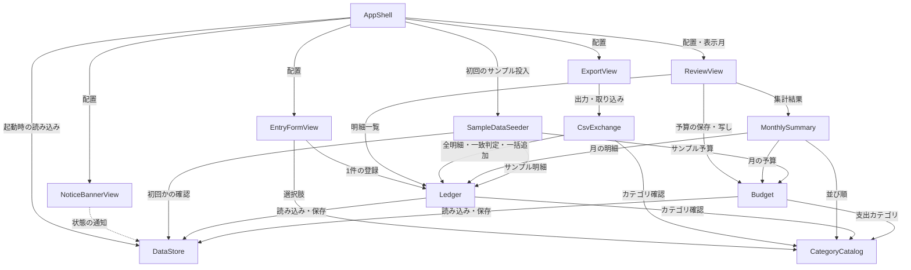

# 部品の一覧（コンポーネントカタログ）

入力: 要件 `aidlc/spaces/default/intents/261016-budget-manager-app/inception/requirements-analysis/requirements.md`、ストーリー `aidlc/spaces/default/intents/261016-budget-manager-app/inception/user-stories/stories.md`（「要件との差分」を含む）、開発の進め方 `aidlc/spaces/default/intents/261016-budget-manager-app/inception/practices-discovery/team-practices.md`、このステージの回答 `domain-design-questions.md`（Q1〜Q4）。

ここで決めるのは、自分たちで書くプログラムのまとまり（部品）と、その役割・データの持ち主・呼び出し関係だけです。使う技術、データの型や検証の細部、部品の置き方（1つにまとめて配るかどうか）は後の段階で決めます。ブラウザの保存領域やファイルの読み書きは部品ではなく、部品が使う外部の仕組みとして扱います。

```yaml
components:
  - name: DataStore
    summary: 明細と予算をまとめた1つのデータを、ブラウザの保存領域に読み書きする
    behaviour: >
      明細と予算を1つのまとまり（スナップショット）として保存し、読み込む。保存は常に全体をまとめて行い、
      途中まで書かれた状態を残さない（全部か無か）。読み込んだデータの形が壊れている・版が分からない場合は
      「読み込めない」状態として報告し、データを消さず、以後の書き込みをすべて断る。保存に失敗したら、
      失敗を呼び出し元に返し、成功したとは扱わない。別のタブが保存したことを検知したら、最新を読み直して
      変更があったことを知らせる。保存データには版を付け、将来の形の変更に備える。
    responsibilities:
      - 明細と予算をまとめたデータの読み込みと保存（全部か無か）
      - 保存データの版の管理と、壊れた・未知の版のデータの検出（書き込みを止める）
      - 保存の失敗の検出と報告
      - 別のタブでの保存の検知と再読み込みの通知
    depends_on: []
    dependents:
      - component: Ledger
        interaction: 明細の読み込みと、明細を加えたデータの保存
      - component: Budget
        interaction: 予算の読み込みと、予算を変えたデータの保存
      - component: SampleDataSeeder
        interaction: 保存データがあるか・壊れていないかの確認と、サンプルを入れたデータの保存
      - component: AppShell
        interaction: 起動時の読み込みと、保存データの状態（正常・壊れている）の取得
      - component: NoticeBannerView
        interaction: 壊れた保存データと別タブの変更の通知を受け取る
    external_dependencies:
      - name: ブラウザの保存領域（Web Storage）
        kind: database
        purpose: 明細と予算のデータを、同じパソコン・同じブラウザに保持する
      - name: ブラウザのタブ間の変更通知（storage イベント）
        kind: other
        purpose: 別のタブでの保存を検知する
    entities:
      - name: StoreSnapshot
        identifier: storageKey
        attributes: [storageKey, schemaVersion, revision, savedAt, entries, budgets]
        references:
          - entity: Entry
            owned_by: Ledger
            relationship: スナップショットは、保存時点のすべての明細を含む
          - entity: MonthlyBudget
            owned_by: Budget
            relationship: スナップショットは、保存時点のすべての月別予算を含む

  - name: CategoryCatalog
    summary: 用意済みのカテゴリ（収入3、支出8）の一覧を提供する
    behaviour: >
      カテゴリは固定で、利用者は追加・名前変更・削除できない。区分（収入・支出）ごとのカテゴリ一覧を返し、
      ある名前のカテゴリが存在するか、区分と合っているかを判定する。一覧の順序は常に同じ。
    responsibilities:
      - 収入カテゴリと支出カテゴリの固定の一覧
      - カテゴリ名の存在と、区分との一致の判定
    depends_on: []
    dependents:
      - component: Ledger
        interaction: 登録する明細のカテゴリが正しいかを確かめる
      - component: Budget
        interaction: 予算を設定できる支出カテゴリの一覧を得る
      - component: MonthlySummary
        interaction: 集計表に並べる支出カテゴリの順序を得る
      - component: CsvExchange
        interaction: 取り込む行のカテゴリが用意されているか・区分と合うかを確かめる
      - component: EntryFormView
        interaction: 区分に合うカテゴリの選択肢を表示する
    external_dependencies: []
    entities:
      - name: Category
        identifier: name
        attributes: [name, kind, displayOrder]

  - name: Ledger
    summary: 収入・支出の明細を受け付け、月ごとに取り出す
    behaviour: >
      明細1件の登録と、取り込み用の複数件の一括追加を受け付ける。どちらも、金額・日付・区分・カテゴリ・メモの
      規則（要件 FR1.2〜FR1.5 とストーリーの差分）を満たさないものは受け付けない。メモの前後の空白は除く。
      明細は登録後に修正・削除できない。一括追加は全件まとめて保存し、失敗したら1件も追加しない。
      月を指定すると、その月の明細を日付の新しい順（同じ日付は後から追加したものが上）で返す。
      既存の明細と日付・区分・カテゴリ・金額・メモがすべて一致するかを判定する。
    responsibilities:
      - 明細の登録（1件）と一括追加（取り込み用、全部か無か）
      - 明細の内容の規則の判定
      - 月ごとの明細の取り出しと並び順
      - 既存の明細との一致の判定（重複の確認用）
    depends_on:
      - component: DataStore
        interaction: 明細を読み込み、追加したデータを保存する
        style: sync
      - component: CategoryCatalog
        interaction: カテゴリの存在と区分との一致を確かめる
        style: sync
    dependents:
      - component: MonthlySummary
        interaction: 指定した月の明細を読む
      - component: CsvExchange
        interaction: 全明細を読む（出力）、一括追加と一致の判定を頼む（取り込み）
      - component: SampleDataSeeder
        interaction: サンプルの明細を一括追加する
      - component: EntryFormView
        interaction: 明細1件の登録を頼む
      - component: ReviewView
        interaction: 表示中の月の明細一覧を読む
    external_dependencies: []
    entities:
      - name: Entry
        identifier: entryId
        attributes: [entryId, date, kind, category, amount, memo, addedOrder]
        references:
          - entity: Category
            owned_by: CategoryCatalog
            relationship: 各明細は、用意済みのカテゴリ1つに属する

  - name: Budget
    summary: 月ごと・支出カテゴリごとの予算を設定・保存し、前の月から写す
    behaviour: >
      月と支出カテゴリの組ごとに、0〜9,999,999 の整数の予算を持つ。空欄は「未設定」を意味し、予算を持たない。
      1か月分の予算はまとめて検証し、1つでも誤りがあれば何も保存しない。前の月の予算を写すとき、前の月に
      予算が1つもなければ何もしない。写し先にすでに予算がある場合は、利用者の確認を経てから上書きする。
      収入カテゴリには予算を設定しない。
    responsibilities:
      - 月・支出カテゴリごとの予算の設定と保存（1か月分をまとめて）
      - 前の月の予算の写し（空のとき・上書きのときの扱い）
      - 指定した月の予算の取り出し
    depends_on:
      - component: DataStore
        interaction: 予算を読み込み、変更したデータを保存する
        style: sync
      - component: CategoryCatalog
        interaction: 予算を設定できる支出カテゴリを得る
        style: sync
    dependents:
      - component: MonthlySummary
        interaction: 指定した月の予算を読む
      - component: SampleDataSeeder
        interaction: サンプルの予算を設定する
      - component: ReviewView
        interaction: 予算の保存と前の月からの写しを頼む
    external_dependencies: []
    entities:
      - name: MonthlyBudget
        identifier: budgetKey
        attributes: [budgetKey, month, category, amount]
        references:
          - entity: Category
            owned_by: CategoryCatalog
            relationship: 各予算は、支出カテゴリ1つに対して月ごとに1つ

  - name: MonthlySummary
    summary: 指定した月の収入・支出・差額と、支出カテゴリ別の予算・実績・残額を計算する
    behaviour: >
      明細と予算を読むだけで、書き換えない。収入合計・支出合計・差額（収入 − 支出）を円の整数で計算する。
      支出カテゴリごとに、実績の合計、予算（未設定ならなし）、残額（予算 − 実績）を出し、実績が予算を超えた
      カテゴリは超過として示す。予算が未設定のカテゴリは超過と扱わない。カテゴリ別実績の合計は支出合計と
      必ず一致する。
    responsibilities:
      - 月の収入合計・支出合計・差額の計算
      - 支出カテゴリ別の予算・実績・残額・超過の判定
    depends_on:
      - component: Ledger
        interaction: 指定した月の明細を読む
        style: sync
      - component: Budget
        interaction: 指定した月の予算を読む
        style: sync
      - component: CategoryCatalog
        interaction: 支出カテゴリの並び順を得る
        style: sync
    dependents:
      - component: ReviewView
        interaction: 表示中の月の集計結果を得る
    external_dependencies: []
    entities: []

  - name: CsvExchange
    summary: 明細の CSV 出力と、CSV からの取り込み（検証・重複の確認を含む）
    behaviour: >
      出力: すべての明細を日付の古い順に、UTF-8（BOM 付き）・CRLF・見出し「日付,区分,カテゴリ,金額,メモ」で
      書き出す。カンマ・ダブルクォートを含む値は引用し、先頭が = + - @ ' タブ 改行のメモには先頭に ' を1つ付ける。
      明細が0件なら出力しない。
      取り込み: ファイル全体を先に確かめ（大きさ・行数の上限、UTF-8 として読めるか、閉じていない引用符、見出し）、
      満たさなければ何も追加しない。次に各行を検証し（列数、日付、区分、カテゴリ、金額、メモの長さと改行）、
      値の前後の空白は除き、空行は無視し、メモ先頭の ' を1つ外す。正しい行のうち既存の明細と一致するものを数え、
      1件以上あれば利用者に「重複分を除いて追加・すべて追加・取り込みをやめる」を選んでもらう。最後に明細の
      一括追加を頼み、追加・取り込めなかった行（行番号と理由）・重複として除いた件数を報告する。
    responsibilities:
      - CSV の形式への変換（出力）と、数式として実行されない対策
      - 取り込みファイルの全体の確認と、行ごとの検証
      - 重複の数え上げと、利用者の選択に応じた追加対象の決定
      - 取り込み結果の報告
    depends_on:
      - component: Ledger
        interaction: 全明細を読む、一致の判定と一括追加を頼む
        style: sync
      - component: CategoryCatalog
        interaction: 行のカテゴリの存在と区分との一致を確かめる
        style: sync
    dependents:
      - component: ExportView
        interaction: CSV の出力と取り込みを頼む
    external_dependencies:
      - name: ブラウザのファイル選択とダウンロード
        kind: other
        purpose: CSV ファイルを読み込む・保存する
    entities:
      - name: ImportReport
        identifier: importId
        attributes: [importId, addedCount, rejectedRows, duplicateCount, fileRejectedReason]

  - name: SampleDataSeeder
    summary: 初めて開いたときだけ、直近3か月分の架空の明細と予算を入れる
    behaviour: >
      保存データがまったくないときだけ動く。保存データが壊れている場合は動かない（入れ直さない）。今月を含む
      直近3か月分の架空の明細と予算を作り、少なくとも1つの月で予算超過と予算未設定のカテゴリが見られるようにする。
      実在の人物・口座・店舗を連想させる内容は使わない。
    responsibilities:
      - 初回かどうかの判定（データなし・壊れていない）
      - 直近3か月分の架空の明細と予算の作成と投入
    depends_on:
      - component: DataStore
        interaction: 保存データがないこと・壊れていないことを確かめる
        style: sync
      - component: Ledger
        interaction: サンプルの明細を一括追加する
        style: sync
      - component: Budget
        interaction: サンプルの予算を設定する
        style: sync
    dependents:
      - component: AppShell
        interaction: 起動時に、初回ならサンプルを入れるよう頼む
    external_dependencies: []
    entities: []

  - name: EntryFormView
    summary: 「1 登録」の画面部品。明細の入力欄と、登録結果の知らせを表示する
    behaviour: >
      計算や保存はせず、入力を Ledger に渡して結果を表示する。区分に合うカテゴリだけを選択肢に出し、
      区分を切り替えると合わない選択を解除する。登録中は「登録する」を押せなくする。誤りは欄ごとに表示し、
      入力値を残す。登録した明細の月が表示中の月と違えば、表示の切り替えを AppShell に頼み、
      その月の明細として登録したことを知らせる。保存データが壊れているときは登録できない理由を表示する。
    responsibilities:
      - 明細の入力欄と、誤り・成功・保存失敗の表示
      - 別の月で登録したときの表示月の切り替えの依頼
    depends_on:
      - component: Ledger
        interaction: 明細1件の登録を頼む
        style: sync
      - component: CategoryCatalog
        interaction: 区分に合うカテゴリの選択肢を得る
        style: sync
    dependents:
      - component: AppShell
        interaction: 画面の「1 登録」の区切りとして配置する
    external_dependencies: []
    entities: []

  - name: ReviewView
    summary: 「2 確認」の画面部品。月の切り替え、月次集計、予算の入力、明細一覧を表示する
    behaviour: >
      計算や保存はせず、MonthlySummary の結果と Ledger の明細を表示し、予算の保存と写しを Budget に頼む。
      上書きの確認は操作したボタンのすぐ下に出す。超過は色に加えて文字で示し、未設定は「未設定」と「—」で示す。
      明細がない月は案内文を出す。保存データが壊れているときは予算の入力と保存を止める。
    responsibilities:
      - 月の切り替えの表示（表示月の値は AppShell が持つ）
      - 集計・予算・明細一覧の表示と、予算の保存・写しの操作
    depends_on:
      - component: MonthlySummary
        interaction: 表示中の月の集計結果を得る
        style: sync
      - component: Budget
        interaction: 予算の保存と前の月からの写しを頼む
        style: sync
      - component: Ledger
        interaction: 表示中の月の明細一覧を得る
        style: sync
    dependents:
      - component: AppShell
        interaction: 画面の「2 確認」の区切りとして配置する
    external_dependencies: []
    entities: []

  - name: ExportView
    summary: 「3 書き出し」の画面部品。CSV の保存・取り込みの操作と結果を表示する
    behaviour: >
      計算や変換はせず、CSV の出力と取り込みを CsvExchange に頼んで結果を表示する。重複の確認は取り込みボタンの
      すぐ下に出す。CSV には明細だけが含まれ予算は含まれないこと、形式を説明文で示す。保存データが壊れている
      ときは取り込みを止める。
    responsibilities:
      - CSV の保存・取り込みの操作
      - 重複の確認、取り込み結果、取り込めない理由の表示
    depends_on:
      - component: CsvExchange
        interaction: CSV の出力と取り込みを頼む
        style: sync
    dependents:
      - component: AppShell
        interaction: 画面の「3 書き出し」の区切りとして配置する
    external_dependencies: []
    entities: []

  - name: NoticeBannerView
    summary: 画面上部の全体のお知らせ枠。保存データの異常と別タブの変更を知らせる
    behaviour: >
      DataStore から、保存データが読み込めないこと、別のタブで変更があり読み直したことを受け取り、
      読み上げ機能にも伝わる形で表示する。
    responsibilities:
      - 保存データの異常と別タブの変更の表示
    depends_on:
      - component: DataStore
        interaction: 保存データの状態と別タブの変更の通知を受け取る
        style: event
    dependents:
      - component: AppShell
        interaction: 画面の上部に配置する
    external_dependencies: []
    entities: []

  - name: AppShell
    summary: 画面全体の組み立てと、起動・表示中の月の管理
    behaviour: >
      起動時に DataStore で保存データを読み込み、初回なら SampleDataSeeder にサンプルを入れてもらう。
      表示中の月（開いた日を含む月で始まる）を持ち、各画面部品に渡す。登録で別の月に切り替える依頼を受ける。
      「本文へ移動」の移動先を登録フォームの見出しにする。
    responsibilities:
      - 起動の順序（読み込み → 初回のサンプル投入）
      - 表示中の月の保持と切り替え
      - 画面部品の配置と、本文へ移動の移動先
    depends_on:
      - component: DataStore
        interaction: 起動時に保存データを読み込み、状態を得る
        style: sync
      - component: SampleDataSeeder
        interaction: 初回ならサンプルを入れるよう頼む
        style: sync
      - component: EntryFormView
        interaction: 「1 登録」を配置し、表示月の切り替え依頼を受ける
        style: sync
      - component: ReviewView
        interaction: 「2 確認」を配置し、表示中の月を渡す
        style: sync
      - component: ExportView
        interaction: 「3 書き出し」を配置する
        style: sync
      - component: NoticeBannerView
        interaction: お知らせ枠を配置する
        style: sync
    dependents: []
    external_dependencies: []
    entities: []
```

## 部品の関係図



<!-- Text fallback: AppShell は DataStore・SampleDataSeeder・EntryFormView・ReviewView・ExportView・NoticeBannerView を使う。NoticeBannerView は DataStore の通知を受ける（点線）。EntryFormView は Ledger と CategoryCatalog、ReviewView は MonthlySummary・Budget・Ledger、ExportView は CsvExchange を使う。CsvExchange は Ledger と CategoryCatalog、MonthlySummary は Ledger・Budget・CategoryCatalog、SampleDataSeeder は DataStore・Ledger・Budget を使う。Ledger と Budget は DataStore と CategoryCatalog を使う。循環はない。 -->

## 部品の一覧表

| 部品 | 目的 | 使う部品 | 使われる部品 | 持つデータ |
|------|------|----------|--------------|------------|
| DataStore | 明細と予算をまとめて保存・読み込み、異常と別タブの検知 | なし | Ledger, Budget, SampleDataSeeder, AppShell, NoticeBannerView | StoreSnapshot |
| CategoryCatalog | 固定のカテゴリ一覧 | なし | Ledger, Budget, MonthlySummary, CsvExchange, EntryFormView | Category |
| Ledger | 明細の登録・一括追加・月ごとの取り出し | DataStore, CategoryCatalog | MonthlySummary, CsvExchange, SampleDataSeeder, EntryFormView, ReviewView | Entry |
| Budget | 月別予算の設定・写し | DataStore, CategoryCatalog | MonthlySummary, SampleDataSeeder, ReviewView | MonthlyBudget |
| MonthlySummary | 月次集計の計算 | Ledger, Budget, CategoryCatalog | ReviewView | なし |
| CsvExchange | CSV の出力・取り込み・検証・重複確認 | Ledger, CategoryCatalog | ExportView | ImportReport |
| SampleDataSeeder | 初回のサンプル投入 | DataStore, Ledger, Budget | AppShell | なし |
| EntryFormView | 「1 登録」の画面 | Ledger, CategoryCatalog | AppShell | なし |
| ReviewView | 「2 確認」の画面 | MonthlySummary, Budget, Ledger | AppShell | なし |
| ExportView | 「3 書き出し」の画面 | CsvExchange | AppShell | なし |
| NoticeBannerView | 全体のお知らせ枠 | DataStore | AppShell | なし |
| AppShell | 画面の組み立て、起動、表示中の月 | DataStore, SampleDataSeeder, EntryFormView, ReviewView, ExportView, NoticeBannerView | なし | なし |

## データの持ち主

| データ | 持ち主の部品 | 識別子 | 属性 | 参照 |
|--------|--------------|--------|------|------|
| StoreSnapshot | DataStore | storageKey | storageKey, schemaVersion, revision, savedAt, entries, budgets | Entry（Ledger）、MonthlyBudget（Budget） |
| Category | CategoryCatalog | name | name, kind, displayOrder | なし |
| Entry | Ledger | entryId | entryId, date, kind, category, amount, memo, addedOrder | Category（CategoryCatalog） |
| MonthlyBudget | Budget | budgetKey | budgetKey, month, category, amount | Category（CategoryCatalog） |
| ImportReport | CsvExchange | importId | importId, addedCount, rejectedRows, duplicateCount, fileRejectedReason | なし |

StoreSnapshot は保存の単位で、中身の明細と予算の持ち主はそれぞれ Ledger と Budget です。DataStore は中身の意味を判断せず、まとめて読み書きするだけです（ADR-001）。

## 外部の仕組み

| 部品 | 外部の仕組み | 種類 | 目的 |
|------|--------------|------|------|
| DataStore | ブラウザの保存領域（Web Storage） | database | 同じパソコン・同じブラウザでデータを保持する |
| DataStore | ブラウザのタブ間の変更通知（storage イベント） | other | 別のタブでの保存を検知する |
| CsvExchange | ブラウザのファイル選択とダウンロード | other | CSV ファイルの読み込み・保存 |

外部への通信を行う仕組みは使いません（要件 NFR3）。

## 部品を分けた理由

| 部品 | 分けた理由 |
|------|------------|
| DataStore | 保存の「全部か無か」、壊れたデータの検出、別タブの検知を1か所に集めるため（Q1、ADR-001）。保存の仕組みが変わっても他の部品に影響しない |
| CategoryCatalog | 登録・予算・集計・CSV の4か所が同じ固定の一覧を使うため。一覧の変更が1か所で済む（ADR-005） |
| Ledger | 明細の規則と持ち主を1か所に決めるため。画面と CSV の両方から同じ規則で登録される |
| Budget | 予算は明細と変更の理由が違い（月ごとの設定・写し）、規則も別なため |
| MonthlySummary | 計算だけを持ち、データを書き換えない。計算のテストを単独で行える（Q2、ADR-002） |
| CsvExchange | CSV の形式・検証・重複確認は変更の理由が明細の規則と違うため（Q3、ADR-003） |
| SampleDataSeeder | 初回だけ動く処理で、通常の登録・予算とは寿命が違うため（ADR-006） |
| EntryFormView / ReviewView / ExportView / NoticeBannerView | 詳細モックアップの3つの区切りとお知らせ枠に対応させ、画面の変更が計算や保存に及ばないようにするため（Q4、ADR-004） |
| AppShell | 起動の順序と表示中の月という、画面全体にまたがる状態を1か所に置くため |

選ばなかった分け方（Alternatives Rejected）:

- 明細と予算を別々に保存する案（Q1 の B）: 取り込みと予算の保存の整合、壊れたデータの扱いが2か所に分かれるため採らない。
- 集計を Ledger の中に置く案（Q2 の B）: Ledger が予算を知る必要が生じ、明細の部品の変更理由が増えるため採らない。
- CSV を Ledger の中に置く案（Q3 の B）: 形式の変更が明細の規則に混ざるため採らない。
- 画面全体を1つの部品にする案（Q4 の B）: 画面の一部の変更が全体に及び、テストもしにくいため採らない。

## ストーリーとの対応

| ストーリー | 主に実現する部品 |
|------------|------------------|
| US1.1 収支を登録する | EntryFormView, Ledger, CategoryCatalog |
| US1.2 入力の誤りに気づいて直す | EntryFormView, Ledger |
| US1.3 別の月の日付で登録する | EntryFormView, AppShell |
| US2.1 月の明細を一覧で見る | ReviewView, Ledger |
| US3.1 月の収支を確認する | ReviewView, MonthlySummary |
| US3.2 カテゴリ別に予算と実績を比べる | ReviewView, MonthlySummary |
| US4.1 月の予算を入力する | ReviewView, Budget |
| US4.2 前の月の予算をコピーする | ReviewView, Budget |
| US5.1 明細を CSV に保存する | ExportView, CsvExchange |
| US5.2 数式のようなメモを安全に出力する | CsvExchange |
| US6.1 CSV を取り込んで明細を追加する | ExportView, CsvExchange, Ledger |
| US6.2 取り込めない行を知る | CsvExchange |
| US6.3 重複した取り込みを避ける | CsvExchange, Ledger |
| US7.1 サンプルデータで試し始める | SampleDataSeeder |
| US7.2 開き直してもデータが残る | DataStore |
| US7.3 保存できないときに気づく | DataStore, NoticeBannerView, EntryFormView |
| US7.4 2つのタブで食い違わない | DataStore, NoticeBannerView |
| US8.1 キーボードだけで一連の操作を終える | AppShell, EntryFormView, ReviewView, ExportView |
