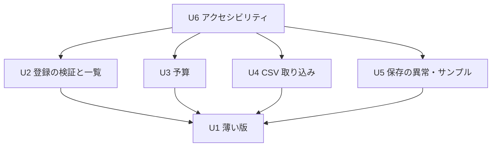

# Unit の依存関係

Unit の定義は `unit-of-work.md` にあります。部品の関係は `aidlc/spaces/default/intents/261016-budget-manager-app/inception/domain-design/components.md` にあり、それをもとにしています。ここでは「どの Unit がどの Unit に依存するか」だけを示します。作る順番は、次のデリバリー計画で決めます。

## 依存関係（DAG）



<!-- Text fallback: U2、U3、U4、U5 はそれぞれ U1 に依存する。U6 は U2、U3、U4、U5 に依存する。循環はない。 -->

| Unit | 依存する Unit | 理由 |
|------|---------------|------|
| U1 | なし | アプリの土台と、すべての部品の最初の形を作る |
| U2 | U1 | U1 の Ledger・EntryFormView・ReviewView に、規則と一覧を足す |
| U3 | U1 | U1 の ReviewView・MonthlySummary・DataStore の上に、予算を足す |
| U4 | U1 | U1 の CsvExchange（出力）・ExportView・Ledger の上に、取り込みを足す |
| U5 | U1 | U1 の DataStore・AppShell の上に、版・照合・異常検出・サンプルを足す |
| U6 | U2, U3, U4, U5 | すべての画面がそろってから、通しで確かめる |

```yaml
units:
  - name: u1-walking-skeleton
    kind: ui
    depends_on: []
  - name: u2-entry-and-ledger
    kind: ui
    depends_on: [u1-walking-skeleton]
  - name: u3-budget
    kind: ui
    depends_on: [u1-walking-skeleton]
  - name: u4-csv-import
    kind: ui
    depends_on: [u1-walking-skeleton]
  - name: u5-storage-resilience
    kind: ui
    depends_on: [u1-walking-skeleton]
  - name: u6-accessibility
    kind: ui
    depends_on: [u2-entry-and-ledger, u3-budget, u4-csv-import, u5-storage-resilience]
```

## 最初の Unit（薄い版）

U1 は依存を持たない唯一の Unit で、どの並べ方でも最初に来ます。U1 だけで次の流れがブラウザ上で動きます。後の Unit を待つ必要はありません。

1. 収支を1件登録する
2. 月次集計に反映される
3. CSV に出力する
4. 開き直しても残っている

## 部品の受け渡し（Unit の間のつながり）

Unit はすべて1つの Web アプリの中で動きます。Unit の間は、部品の公開された呼び出しでつながります。共有するデータは、DataStore が保存する1つのまとまりだけです。

| つながり | 内容 |
|----------|------|
| U2・U4 → U1 の Ledger | 規則の判定（保存なし）、一括追加、一致の判定。規則の定義は Ledger の1か所に置く |
| U3 → U1 の MonthlySummary・ReviewView | 予算比較の列を足す |
| U5 → U1 の DataStore・AppShell | 版・通し番号・照合・状態の通知を足す。保存の形（全体をまとめて保存）は U1 で決めたものを保つ |
| U2〜U5 → U1 の AppShell | 表示中の月と、保存データの状態を受け取る |

## 並行して作れる組み合わせ

U2・U3・U4・U5 は互いに依存しないので、U1 のあとに並行して作れます（依頼者の回答 Q2）。並行して作る場合の決まりは次のとおりです（team-practices.md）。

- 担当ごとに別のブランチと worktree を使う。
- ブランチは `feat/budget-manager-app` から作り、`feat/budget-manager-app` へ戻す。
- 戻したあとにテストを再実行する。

並行するときに同じファイルを触りやすい場所:

- ReviewView: U2 は一覧、U3 は予算を受け持つ。
- Ledger: U2 は規則、U4 は一括追加を受け持つ。
- AppShell: U2 は表示月の切り替え、U5 は状態の伝達を受け持つ。

実際に並行するか、どの順で作るかは、デリバリー計画で決めます。
